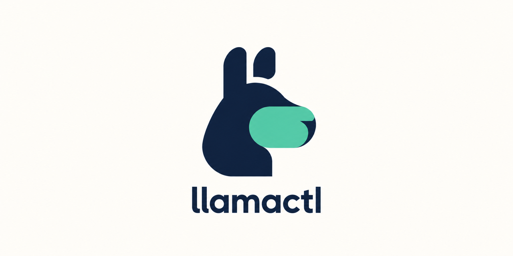

# llamactl

<p align="center">
  
</p>

Local-first control plane for llama.cpp fleets. Discover models,
tune and benchmark presets, run `llama-server` on one or many
machines, and deploy the same infra everywhere through declarative
manifests — all from a single CLI and a browser console
(`llamactl console`).

Think `kubectl` scoped to a single-operator AI stack: one control
plane, N agent nodes, the same verbs (apply, get, describe, delete)
across `ModelRun` and `NodeRun` manifests, plus enough imperative
escape hatches that one-off operations stay trivial.

## Chat with a model

Open **Chat** in the web console. Choose a host with the tab's node
picker, then choose one of its served models. Replies stream as the model
generates them, with Markdown formatting for headings, tables, and code blocks.
Expand **Thinking** to read reasoning provided by the model. The reply shows
output tokens and generation speed when the stream provides enough data. The
`≈` prefix marks a rate measured from token counts and response timing in the browser.
Follow-up messages include the current conversation. Use **Stop** to interrupt generation and **New chat** to clear the conversation.
Chat keeps the transcript in memory until you leave the page or change nodes.

## Fleet telemetry

Open **Fleet Stats** in `llamactl console` for workload status, node memory,
slot occupancy, queue depth, and recent request timings. **Runs** shows busy
slots, recent inference requests, and benchmark results by node. Metrics depend
on the agent version and engine instrumentation. The console marks stale
supervisor samples and shows a dash for unavailable metrics.

Kapitsa control protocol 1 provides live slots, waiting requests, GPU memory
and recent completion timings over the workload's own Unix socket. Waiting
requests include requests still processing input. The first token estimate combines the recorded slot wait and prefill durations. Gufo
reports TTFT from its request log and slot occupancy and queue depth from its
engine endpoints.

For a model served outside Llamactl, place an `observed-models.json` file in
the serving agent's resolved `LOCAL_AI_RUNTIME_DIR` or set
`LLAMACTL_OBSERVED_MODELS_FILE` on that agent. List exact model IDs and local
HTTP ports.

```json
[{ "port": 8085, "model": "example-model" }]
```

Fleet Stats checks the node's loopback `GET /v1/models` and reports whether
each configured ID is advertised. An inventory entry grants no routing
or lifecycle controls. Agent versions that predate request observations
continue to show their supervisor snapshots.

To include **Penumbra handoffs** in Runs, start the console with the Penumbra
daemon's URL and a local file containing its bearer token. The value is parsed
as a standard (WHATWG) URL and used only if the parsed scheme is `http`, the
host is `127.0.0.1`, and the path is `/`, with no credentials, query, or
fragment. Spellings the parser normalizes to that form also work: uppercase
`HTTP://`, short IPv4 forms such as `127.1`, a dot-segment path such as
`/a/..`, or an empty `?` or `#`. With no port, the URL uses port 80.
`localhost`, `[::1]`, `https://`, and any other path leave the Penumbra panel
unavailable.

```sh
LLAMACTL_PENUMBRA_URL=http://127.0.0.1:51257 \
LLAMACTL_PENUMBRA_TOKEN_FILE="$HOME/.penumbra/token" \
llamactl console
```

The token file must be a regular file of at most 4 KiB; it is opened without
following symlinks, so a symlinked or larger file leaves the Penumbra panel
unavailable.

Use the daemon's actual port, or a forward to it that listens on
`127.0.0.1`. The console keeps the token server-side and displays only
handoff IDs, seats, timestamps, and status. Penumbra can continue to use
the model proxy independently.
The daemon's handoff list has no row limit, so the console asks it only for
active handoffs (pending, approved, dispatched). A successful answer is reused
for up to 10 seconds across all open tabs, a failed read for only up to
2 seconds, so the panel recovers about 2 s after the daemon comes back. Recent
terminal handoffs appear when the console reads from the adapter below.

For a colocated deployment with a large handoff database, the loopback
`tools/penumbra-handoff-feed.ts` adapter serves the same metadata from
a read-only SQLite connection. Start it with an absolute database path,
an absolute path to a dedicated bearer-token file, and a port. Point the
console's Penumbra URL and token-file settings at the adapter. Each sample
shows up to 30 active handoffs and up to 30 terminal handoffs from the
256 most recently inserted rows. The adapter requires access to Penumbra's
live SQLite database and its WAL files.

## Highlights

- **Single-machine workflow unchanged.** `llamactl bench`, `llamactl
server start`, `llamactl catalog list` all still work against the
  local node without any configuration.
- **Remote agents.** Any machine on the LAN can run
  `llamactl agent serve`, and the control plane drives it via
  HTTPS + bearer auth + pinned self-signed TLS. `--node gpu1 …` on
  every verb. `-n all` for fan-out.
- **Cloud + gateway nodes as first-class peers.** OpenAI, Anthropic,
  Together, Groq, Mistral, sirius-gateway, embersynth — each shows up
  in kubeconfig with the same `--node` addressing as a self-hosted
  agent.
- **Declarative workloads.** `ModelRun` manifests (a model bound to
  a node with args) and `NodeRun` manifests (an agent's desired
  infra stack — llama.cpp build pinned to a commit, optional sirius /
  embersynth sidecars) are `apply`-able, `get`-able, `delete`-able.
  Optional controller daemon reconciles on a timer.
- **Infra deploy** (I-α / I-β / I.4). The agent ships with a
  registry of known packages, side-by-side versioned layout under
  `~/.llamactl/infra/<pkg>/<version>/`, atomic symlink flip to
  activate, service-unit templates for launchd + systemd.
- **Artifact pipeline** (I.5). Signed, per-platform pre-built
  `llamactl-agent` binaries attached to GitHub Releases; operators
  bootstrap a fresh Mac mini via `llamactl artifacts fetch
--verify-sig`.
- **Reverse tunnel** (I.3). WebSocket tunnel from NAT'd agents back
  to central with jittered-backoff reconnect + heartbeat. Lets a
  home-lab node participate in a fleet without port-forwarding.
- **MCP server.** Every operator surface exposes as `@llamactl/mcp`
  tools — an LLM client (Claude, a cost-guardian agent, a planner)
  drives the fleet the same way the CLI does.
- **Agentic harnesses.** Self-healing probe loop writes a journal;
  runbooks (`audit-fleet`, `drain-node`, `promote-fastest-vision-
model`, `onboard-new-gpu-node`) are deterministic, LLM-driven
  scripts over the MCP surface.

## Architecture

```
                    ~/.llamactl/
                    ├── config           (kubeconfig-style YAML)
                    ├── tokens/<user>    (bearer tokens, chmod 600)
                    ├── workloads/*.yaml (ModelRun + NodeRun manifests)
                    ├── usage/           (JSONL usage sink, N.3)
                    ├── mcp/audit/       (per-tool audit records)
                    └── infra/           (versioned per-node installs)
                              │
                              ▼ reads on each invocation
┌──────────────────────────────────────────────────────────────┐
│ llamactl CLI (Bun)                                           │
│  dispatcher:                                                 │
│   - local  → appRouter.createCaller({env, auth}) in-proc     │
│   - remote → @trpc/client v11 over HTTPS + pinned TLS        │
└──────┬──────────────────────────────────────────┬────────────┘
       │ in-proc                                   │ HTTPS :7843, Bearer <tok>
       ▼                                           ▼
┌──────────────────────────┐     ┌───────────────────────────────────┐
│ packages/core            │     │ llamactl agent serve (on node)    │
│ (pull, server, bench,    │◄────│ Bun.serve + tRPC fetch adapter    │
│  catalog, keep-alive,    │     │   + auth middleware + TLS pinned  │
│  candidate-test,         │     │ Mounts appRouter from @llamactl/  │
│  recommendations, …)     │     │   remote                          │
└──────────────────────────┘     └───────────────────────────────────┘

┌──────────────────────────┐
│ packages/app (web        │ ─── tRPC HTTP/SSE ──► console server ──► same appRouter
│  console, Bun-served)    │
└──────────────────────────┘
```

**One router, three mounts**: the Bun-served web console over tRPC
HTTP/SSE (the only UI runtime since #410 P7-A), agent HTTP / SSE,
in-proc via `createCaller`. Core stays adapter-free.

## Package layout

```
packages/
├── core/        tRPC-adapter-free business logic — catalog, bench,
│                server lifecycle, pull, discovery, candidate-test,
│                profile detection, keep-alive, node facts.
├── cli/         Bun CLI entrypoint. `llamactl <verb>` commands +
│                dispatcher routing --node through in-proc or remote.
├── remote/      Shared tRPC router + agent/server mount +
│                kubeconfig + infra + workload reconcilers + tunnel.
│                Consumed by cli, app, and the agent.
├── app/         Bun-served web console (React 19 + Vite, the only UI
│                runtime since #410 P7-A) — fleet, workloads, nodes and
│                logs views over tRPC HTTP/SSE; `llamactl console`
│                serves the `build:web` bundle on loopback.
├── mcp/         `@llamactl/mcp` — stdio MCP server projecting the tRPC
│                surface as 18 tools across: catalog (list, promote,
│                promoteDelete), node (ls, facts, add, remove),
│                bench (compare, history), server (status), workload
│                (list, delete), promotions (list), env, cost.snapshot,
│                embersynth (sync, set-default-profile), and
│                operator.plan (multi-turn history, stub + LLM).
└── agents/      Self-healing harness (probe loop + journal) +
                 runbooks + tool-call harness.
```

## Quick start

```bash
# Install the CLI wrapper
./scripts/install-cli.sh
llamactl --help

# Single-machine
bun install
bun packages/cli/src/bin.ts catalog list
bun packages/cli/src/bin.ts server start <rel>.gguf

# Add a remote agent
#   On the agent machine:
bun packages/cli/src/bin.ts agent init        # prints bootstrap blob
bun packages/cli/src/bin.ts agent serve

#   On the control plane:
bun packages/cli/src/bin.ts node add --bootstrap <b64-blob>
bun packages/cli/src/bin.ts --node gpu1 catalog list

# Apply a workload manifest
cat > ~/.llamactl/workloads/gemma-qa.yaml <<EOF
apiVersion: llamactl/v1
kind: ModelRun
metadata: { name: gemma-qa }
spec:
  node: gpu1
  target:
    kind: rel
    value: gemma-4-31B-it-GGUF/gemma-4-31B-it-UD-Q4_K_XL.gguf
  extraArgs: ["--ctx-size", "32768", "--flash-attn"]
  restartPolicy: Always
EOF
bun packages/cli/src/bin.ts apply -f ~/.llamactl/workloads/gemma-qa.yaml
bun packages/cli/src/bin.ts get workloads

# Bootstrap a fresh host from a signed release
bun packages/cli/src/bin.ts artifacts fetch --verify-sig
```

### Updating a source install

A host that runs the controller and agent as services from this checkout
updates itself in place; the model hosts keep serving:

```bash
llamactl update            # fetch; show commits, dependency changes, CI, services, hosts
llamactl update --apply    # stop controller, switch, bun install, restart, verify; auto-rollback
llamactl update --rollback # back to where the last update came from
```

See [`docs/self-update.md`](./docs/self-update.md) for the procedure, its
gates and the systemd/launchd configuration.

## CLI surface (selected)

| Verb                                                   | Purpose                                                                 |
| ------------------------------------------------------ | ----------------------------------------------------------------------- |
| `catalog list / status / promote`                      | Curated-model registry on the target node.                              |
| `pull file / candidate`                                | Stream HuggingFace downloads via the node.                              |
| `server start / stop / logs / status`                  | Launch + supervise `llama-server`.                                      |
| `bench preset / vision / compare / show / schedule`    | Tuning + regression benchmarks, plus recurring benches (`run` loops).   |
| `candidate test`                                       | Evaluate a model against a fixed prompt suite.                          |
| `recommendations`                                      | Size- and capability-aware suggestions.                                 |
| `apply / get / describe / delete`                      | Declarative `ModelRun` + `NodeRun` manifests.                           |
| `controller serve`                                     | Optional reconciler daemon.                                             |
| `agent init / serve / rotate-token`                    | Node-agent lifecycle.                                                   |
| `node add / ls / rm / refresh / test`                  | Kubeconfig management.                                                  |
| `ctx use / current / get`                              | Context switching.                                                      |
| `artifacts list / build-agent / fetch / show-path`     | Agent binary distribution with cosign-keyless verification.             |
| `infra install / uninstall / list / status / activate` | Versioned package manager for llama.cpp + sidecars.                     |
| `deploy-node`                                          | One-shot bootstrap: install infra + start agent + print bootstrap blob. |
| `heal tick / serve`                                    | Probe loop + journal for fleet health.                                  |
| `runbook list / run`                                   | Deterministic operator automation.                                      |
| `sirius providers list / add / remove`                 | Sirius-gateway config edits.                                            |
| `embersynth sync`                                      | Push llamactl-derived config to embersynth.                             |
| `update [--check \| --apply \| --rollback]`            | Self-update a source install; model hosts keep serving.                 |

Run `llamactl <verb> --help` for the full flag surface.

## Reverse tunnel (I.3)

Agents behind NAT dial `wss://central/tunnel` themselves. Handshake:
first message carries bearer + nodeName; server validates + registers
the node in an in-memory `{nodeName → ws}` map; requests from central
flow in as `{type:'req', id, method, params}` frames and the agent
replies in kind. Client maintains jittered-exp-backoff reconnect
(1s–60s, ±20% jitter), heartbeat (25s interval, 5s timeout),
correlation-id-keyed pending-request map that rejects cleanly on
disconnect.

See `packages/remote/src/tunnel/`. Dispatcher integration (I.3.3) is
a follow-up.

## Agentic harnesses

**Self-healing probe loop** (`packages/agents/src/healer/`):

```bash
llamactl heal serve --interval=10s
# tail ~/.llamactl/healer/journal.jsonl to observe transitions
```

Polls every known node + gateway, detects state transitions
(healthy → degraded → down and back), journals each tick, fires
optional remediation callbacks.

**Runbooks** (`packages/agents/src/runbooks/`):

```bash
llamactl runbook list
llamactl runbook run promote-fastest-vision-model
```

Each runbook is a deterministic sequence of MCP tool calls described
declaratively. Shipped set:

- `audit-fleet` — snapshot + health of every node.
- `drain-node` — gracefully stop workloads on a node.
- `onboard-new-gpu-node` — install infra, start agent, register.
- `promote-fastest-vision-model` — benchmark-driven preset update.

Runbooks compose the same MCP tools `nova.operator.plan` will emit,
so hand-written runbooks and LLM-planned runbooks execute through the
same harness.

## Documentation

- `docs/releases.md` — tagging, release workflow, artifact binding.
- `docs/tsv-schemas.md` — curated-models, preset-overrides,
  llama-bench-profiles, llama-bench-history, bench-vision schemas.
- `docs/self-update.md` — `llamactl update`: check, apply and roll back
  a source install (git checkout + bun services) without stopping the
  model hosts.
- `docs/dynamic-fleet-models.md`: dynamic fleet models, qualification
  and promotion, exclusive-window runbook.
- `docs/` gains more as features stabilize.

## Tests

```bash
bun test              # per-package bun:test suites
bun run typecheck     # core + cli
zsh test/run-all.zsh  # full sweep including shell smoke tests
```

End-to-end verification after any cross-cutting change runs all four
repos' test suites in lockstep (llamactl + sirius-gateway +
embersynth + nova must all stay green).

## License

MIT.
